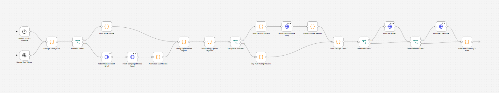

# n8n-outbound-sequence-step-pacing-optimization-engine

> Outbound optimization workflow that adjusts time gaps between cold email sequence steps based on mailbox health metrics and prospect engagement velocity.

Every morning at 07:00 UTC the workflow scores each sending mailbox, rolls that health up to every campaign, measures how fast prospects engage at each step, and proposes new step-to-step delays. It tightens gaps for fast segments, stretches them for slow ones, and throttles any campaign whose mailboxes are under stress. A set of guardrails caps every change. The workflow then posts a Slack Block Kit summary and writes one audit record per run.

It is **safe by default**. Imported as-is, it reads a synthetic fixture, makes **zero network calls**, and writes nothing.

---

## Table of contents

1. [Architecture overview](#1-architecture-overview)
2. [Repository layout](#2-repository-layout)
3. [Prerequisites & required API scopes](#3-prerequisites--required-api-scopes)
4. [5-minute sandbox quick start](#4-5-minute-sandbox-quick-start)
5. [Step-by-step import & configuration](#5-step-by-step-import--configuration)
6. [Environment variables](#6-environment-variables)
7. [Live data contract (adapter API)](#7-live-data-contract-adapter-api)
8. [Pacing optimization algorithm](#8-pacing-optimization-algorithm)
9. [Safety limits & guardrails](#9-safety-limits--guardrails)
10. [RevOps best practices](#10-revops-best-practices)
11. [Safety matrix](#11-safety-matrix)
12. [Data protection & compliance checklist](#12-data-protection--compliance-checklist)
13. [Troubleshooting](#13-troubleshooting)
14. [Disclaimer & license](#-disclaimer--liability-limitation)

---

## 1. Architecture overview



| Stage | Node(s) | Purpose |
|---|---|---|
| Triggers | `Daily 07:00 UTC Schedule`, `Manual Test Trigger` | Daily cron (`0 7 * * *`, workflow timezone UTC) or an on-demand test run |
| Config & safety gate | `Config & Safety Gate` | Reads every setting from `$env`, validates it, and computes the effective mode. Secrets never enter execution data; only "is it set?" booleans do |
| Data source router | `Sandbox Mode?` → `Load Mock Fixture` **or** `Fetch Mailbox Health (Live)` → `Fetch Campaign Metrics (Live)` → `Normalize Live Metrics` | Synthetic fixture in sandbox; read-only `GET` calls when live |
| Optimization engine | `Pacing Optimization Engine` | Mailbox health scoring, campaign roll-up, step velocity, proposed delays, guardrails, circuit breaker |
| Pacing update | `Build Pacing Update Payloads` → `Live Update Allowed?` → `Split Pacing Payloads` → `Apply Pacing Update (Live)` → `Collect Update Results` **or** `Dry-Run Pacing Preview` | Builds one batch payload per campaign; sends it only if every safety flag agrees |
| Alerts | `Build RevOps Alerts` → `Send Slack Alert?` → `Post Slack Alert` → `Send Webhook Alert?` → `Post Alert Webhook` | Slack Block Kit alert plus a compact JSON webhook event |
| Audit | `Execution Summary & Audit` | One structured audit record per run |

### Data flow

```mermaid
flowchart LR
    A1[Daily 07:00 UTC Schedule] --> B
    A2[Manual Test Trigger] --> B
    B[Config & Safety Gate<br/>env vars · validation · mode] --> C{Sandbox Mode?}
    C -- true --> D[Load Mock Fixture<br/>synthetic data]
    C -- false --> E1[GET Mailbox Health]
    E1 --> E2[GET Campaign Metrics]
    E2 --> E3[Normalize Live Metrics]
    D --> F[Pacing Optimization Engine<br/>health score · velocity · guardrails · circuit breaker]
    E3 --> F
    F --> G[Build Pacing Update Payloads]
    G --> H{Live Update Allowed?}
    H -- true --> I1[Split Pacing Payloads<br/>second safety interlock]
    I1 --> I2[POST Pacing Update<br/>Idempotency-Key · 1.5s spacing]
    I2 --> I3[Collect Update Results]
    H -- false --> J[Dry-Run Pacing Preview]
    I3 --> K[Build RevOps Alerts<br/>Slack Block Kit + webhook event]
    J --> K
    K --> L{Send Slack Alert?}
    L -- true --> M[Post Slack Alert]
    L -- false --> N{Send Webhook Alert?}
    M --> N
    N -- true --> O[Post Alert Webhook]
    N -- false --> P[Execution Summary & Audit]
    O --> P
```



---

## 2. Repository layout

```
n8n-outbound-sequence-step-pacing-optimization-engine/
├── workflow.json                                   # Importable n8n workflow (25 nodes incl. 4 sticky notes)
├── README.md                                       # This file
├── DISCLAIMER.md                                   # Liability limitation
├── LICENSE                                         # MIT
├── .env.example                                    # Sample environment file (placeholders only)
├── .gitignore
├── sample-payloads/
│   └── outbound-sequence-metrics-fixture.json      # Synthetic mailbox, campaign & engagement data
└── scripts/
    └── simulate-sandbox-run.js                     # Offline simulator: runs the Code nodes in plain Node.js
```

The fixture embedded in the `Load Mock Fixture` node is identical to `sample-payloads/outbound-sequence-metrics-fixture.json`.

---

## 3. Prerequisites & required API scopes

| Requirement | Detail |
|---|---|
| n8n | Self-hosted n8n **1.x or 2.x** (Code node v2, IF node v2, HTTP Request node v4.2, Schedule Trigger v1.2) |
| Env access | `N8N_BLOCK_ENV_ACCESS_IN_NODE=false` so Code nodes and expressions can read `$env`. If access is blocked, the gate falls back to safe defaults (sandbox, dry run) and records why |
| n8n Cloud | Cloud does not expose custom environment variables. Use n8n Variables (`$vars.NAME`) instead: find-and-replace `$env.` with `$vars.` in the workflow JSON, and in `Config & Safety Gate` |
| Node.js (optional) | Node 18+ to run `scripts/simulate-sandbox-run.js` locally |
| Outbound platform | API access to Smartlead, Instantly, Apollo, or similar, **or** a thin adapter service (see [§7](#7-live-data-contract-adapter-api)) |
| Slack (optional) | An incoming webhook for the RevOps alert channel |

### Minimum API permissions (least privilege)

| Integration | Read | Write | Notes |
|---|---|---|---|
| Outbound platform: mailboxes | Email account / mailbox list, sending stats, bounce & complaint counts, warm-up reputation | none | Used by `Fetch Mailbox Health (Live)` |
| Outbound platform: campaigns | Campaign list & status, sequence steps & delays, per-step sends/clicks/replies/unsubscribes | none | Used by `Fetch Campaign Metrics (Live)` |
| Outbound platform: sequence settings | none | Update step delay / wait days only | Used by `Apply Pacing Update (Live)`. Grant only when you are ready for live writes |
| Slack | none | `incoming-webhook` for one channel | Used by `Post Slack Alert` |
| Generic webhook | none | `POST` to your endpoint | Used by `Post Alert Webhook` (SIEM, data warehouse, PagerDuty bridge, etc.) |

If your platform cannot scope a key to read-only access, use **separate keys**: a read-only key for the dry-run phase, and a write-capable key only after sign-off.

---

## 4. 5-minute sandbox quick start

1. **Import.** In n8n go to *Workflows → Import from File* and choose `workflow.json`.
2. **Leave every flag at its default.** No variables are required for sandbox mode.
3. **Run it.** Open the workflow and click **Test workflow** (this fires `Manual Test Trigger`).
4. **Inspect the result.**
   - `Pacing Optimization Engine` shows the full plan: mailbox scores, campaign tiers, and step-by-step proposals with reasons.
   - `Dry-Run Pacing Preview` shows each `would_send` request: URL, method and body.
   - `Build RevOps Alerts → alerts.slackPayload` holds the Block Kit JSON. Paste it into [Slack Block Kit Builder](https://app.slack.com/block-kit-builder) to preview it.
   - `Execution Summary & Audit` holds the audit record.
5. **(Optional) Run offline, without n8n:**

   ```bash
   node scripts/simulate-sandbox-run.js            # audit record
   node scripts/simulate-sandbox-run.js --plan     # full engine output
   node scripts/simulate-sandbox-run.js --slack    # Slack Block Kit payload
   CIRCUIT_BREAKER_CRITICAL_MAILBOX_PCT=10 node scripts/simulate-sandbox-run.js   # trip the breaker
   ```

### Expected sandbox result (default thresholds)

| Campaign | Mailbox health | Velocity | Proposed changes | Decision |
|---|---|---|---|---|
| `77001` Q4 FinOps Leaders | HEALTHY | HIGH (+27% vs baseline) | Step 1→2: 3d → **2d**, Step 2→3: 4d → **3d** | UPDATE (compress) |
| `77002` RevOps Directors | HEALTHY | STALLED (−48% vs baseline) | 3d → **5d**, 4d → **5d**, 5d → **7d** | UPDATE (expand) |
| `77003` IT Security Buyers | THROTTLE (`mbx_06` critical, `mbx_05` throttle) | NORMAL | 3d → **5d**, 4d → **6d** (compression blocked), 5d → **7d** (capped at +2d) | UPDATE (throttle) |
| `77004` Founders Pilot | HEALTHY | INSUFFICIENT_DATA (64 sends) | none | NO_CHANGE |
| `77005` Legacy Webinar | n/a | n/a | none | SKIPPED_INACTIVE (paused) |

The run severity is **CRITICAL** because `mbx_06` has a 6.4% bounce rate and a 0.49% spam complaint rate. Every update shows `SANDBOX_PREVIEW`, and nothing is sent.

---

## 5. Step-by-step import & configuration

### Phase 1 — Sandbox (no credentials)
Follow the quick start. Tune thresholds with environment variables, and use the simulator to see their effect before you touch live data.

### Phase 2 — Live reads, dry run
1. Set your secrets in the n8n host environment or secret manager, never in the workflow:
   `OUTBOUND_API_KEY`, `OUTBOUND_API_BASE_URL`, and optionally `SLACK_ALERT_WEBHOOK_URL`.
2. Set the endpoint paths (`OUTBOUND_MAILBOX_HEALTH_PATH`, `OUTBOUND_CAMPAIGN_METRICS_PATH`), or point the base URL at your adapter.
3. Restrict scope with `OUTBOUND_CAMPAIGN_IDS=77001,77002` while you validate.
4. Set `SANDBOX_MODE=false`. Leave `DRY_RUN=true` and `PACING_UPDATES_ENABLED=false`.
5. Optionally set `SEND_SLACK_ALERTS=true` to receive dry-run alerts in Slack.
6. Restart n8n so it picks up the new environment, then run manually. Check `Normalize Live Metrics` against what your platform UI shows.
7. Activate the workflow and let it run daily in dry-run mode for **at least one to two weeks**. Compare its proposals with what your team would have done.

> The gate refuses live mode, and silently stays in sandbox, if `OUTBOUND_API_KEY` is missing, if the base URL is not `https://`, or if the base URL is still the `example.com` placeholder. The reason appears in `gate.reasons`.

### Phase 3 — Live writes
1. Confirm the update endpoint changes **only delays**. Some platforms resubmit the full sequence, including email copy, when you save a delay. If yours does, put an adapter in front of it.
2. Set `DRY_RUN=false` **and** `PACING_UPDATES_ENABLED=true`.
3. Start with `MAX_CAMPAIGNS_UPDATED_PER_RUN=3` and a narrow `OUTBOUND_CAMPAIGN_IDS`.
4. Review `Collect Update Results` and the audit record after every run for the first week. Then widen the scope.

### Rollback
Set `PACING_UPDATES_ENABLED=false` (or `DRY_RUN=true`) to stop writes immediately. Every audit record contains `from_days` for each change, which is enough to restore the previous delays.

---

## 6. Environment variables

### Safety flags & modes

| Variable | Default | Description |
|---|---|---|
| `SANDBOX_MODE` | `true` | Use the embedded synthetic fixture. Blocks **all** network calls, including alerts |
| `DRY_RUN` | `true` | Read live data but never write to the outbound platform |
| `PACING_UPDATES_ENABLED` | `false` | Master switch for pacing writes. Must be `true` together with `DRY_RUN=false` |
| `SEND_SLACK_ALERTS` | `false` | Post the Block Kit alert to `SLACK_ALERT_WEBHOOK_URL` (never in sandbox) |
| `SEND_WEBHOOK_ALERTS` | `false` | Post the JSON event to `ALERT_WEBHOOK_URL` (never in sandbox) |
| `ALERT_MIN_SEVERITY` | `WARNING` | Minimum run severity that dispatches alerts: `INFO`, `WARNING` or `CRITICAL` |
| `ALERT_MAX_ITEMS_PER_SECTION` | `8` | Maximum rows per Slack section. The rest stay in the audit log |

Booleans accept `true/false/1/0/yes/no/on/off`. Any other value falls back to the safe default and is logged in `gate.warnings`.

### Outbound platform & secrets

| Variable | Default | Secret | Description |
|---|---|---|---|
| `OUTBOUND_API_KEY` | — | ✅ | Bearer token, read only inside HTTP node expressions |
| `OUTBOUND_API_BASE_URL` | `https://api.outbound-platform.example.com/v1` | | Platform or adapter base URL (must be `https://`) |
| `OUTBOUND_PLATFORM` | `generic` | | Label recorded in the audit log |
| `OUTBOUND_MAILBOX_HEALTH_PATH` | `/mailboxes/health` | | `GET` endpoint for mailbox metrics |
| `OUTBOUND_CAMPAIGN_METRICS_PATH` | `/campaigns/sequence-metrics` | | `GET` endpoint for campaigns, steps and engagement |
| `OUTBOUND_PACING_UPDATE_PATH` | `/campaigns/{campaign_id}/sequence-delays` | | `POST` endpoint. `{campaign_id}` is substituted |
| `OUTBOUND_CAMPAIGN_IDS` | *(all)* | | Comma-separated allow-list, e.g. `77001,77002` |
| `METRICS_LOOKBACK_DAYS` | `7` | | Sent as the `lookback_days` query parameter |
| `SLACK_ALERT_WEBHOOK_URL` | — | ✅ | Slack incoming webhook URL |
| `ALERT_WEBHOOK_URL` | — | ✅ | Generic JSON webhook endpoint |

### Mailbox health thresholds

| Variable | Default | Description |
|---|---|---|
| `BOUNCE_RATE_WARN_PCT` | `2.0` | At or above this, the mailbox is at least WATCH |
| `BOUNCE_RATE_THROTTLE_PCT` | `3.0` | At or above this, the mailbox is at least THROTTLE |
| `BOUNCE_RATE_CRITICAL_PCT` | `5.0` | At or above this, the mailbox is CRITICAL |
| `SPAM_RATE_WARN_PCT` | `0.1` | Spam complaint warn level |
| `SPAM_RATE_CRITICAL_PCT` | `0.3` | Spam complaint critical level |
| `VOLUME_UTILIZATION_WARN_PCT` | `90` | Penalize mailboxes sending above this share of their daily limit |
| `WARMUP_REPUTATION_FLOOR_PCT` | `90` | Penalize warm-up reputation below this |
| `MIN_MAILBOX_SAMPLE_SIZE` | `50` | Flags low-sample mailboxes (their rates are noisy) |
| `UNSUBSCRIBE_RATE_GUARD_PCT` | `1.0` | Cancels compression when a step's unsubscribe rate reaches this |

### Pacing bounds

| Variable | Default | Description |
|---|---|---|
| `MIN_STEP_DELAY_DAYS` | `2` | Floor for any step gap |
| `MAX_STEP_DELAY_DAYS` | `10` | Ceiling for any step gap |
| `MAX_DELAY_CHANGE_DAYS_PER_RUN` | `2` | Largest change to a single gap per run |
| `MIN_STEP_SAMPLE_SIZE` | `100` | Minimum sends on a step before its velocity is trusted |
| `MAX_CAMPAIGNS_UPDATED_PER_RUN` | `25` | Cap on campaigns written per run, worst health first |

### Velocity model & multipliers

| Variable | Default | Description |
|---|---|---|
| `BENCHMARK_REPLY_RATE_PCT` | `2.0` | Reply-rate benchmark (index weight 0.60) |
| `BENCHMARK_CLICK_RATE_PCT` | `1.5` | Click-rate benchmark (index weight 0.25) |
| `BENCHMARK_HOURS_TO_ENGAGEMENT` | `48` | Time-to-engagement benchmark (index weight 0.15) |
| `VELOCITY_HIGH_THRESHOLD` | `1.3` | Index at or above this is HIGH |
| `VELOCITY_SLUGGISH_THRESHOLD` | `0.8` | Index below this is SLUGGISH |
| `VELOCITY_STALLED_THRESHOLD` | `0.5` | Index below this is STALLED |
| `VELOCITY_COMPRESS_MULTIPLIER` | `0.75` | Gap multiplier for HIGH velocity |
| `VELOCITY_EXPAND_MULTIPLIER` | `1.35` | Gap multiplier for SLUGGISH velocity |
| `VELOCITY_STALLED_MULTIPLIER` | `1.6` | Gap multiplier for STALLED velocity |
| `VELOCITY_SHIFT_ALERT_PCT` | `25` | Flags a campaign whose velocity moves this far from its 30-day baseline |
| `HEALTH_WATCH_MULTIPLIER` | `1.15` | Gap multiplier when campaign health is WATCH |
| `HEALTH_THROTTLE_MULTIPLIER` | `1.5` | Gap multiplier when campaign health is THROTTLE |
| `CIRCUIT_BREAKER_CRITICAL_MAILBOX_PCT` | `30` | Trip when this share of active mailboxes is CRITICAL |
| `CIRCUIT_BREAKER_BOUNCE_RATE_PCT` | `5.0` | Trip when the send-weighted org bounce rate reaches this |

### Sample `.env`

The same content is in `.env.example`.

```dotenv
# n8n runtime
N8N_BLOCK_ENV_ACCESS_IN_NODE=false
GENERIC_TIMEZONE=UTC

# Safety flags (safe defaults)
SANDBOX_MODE=true
DRY_RUN=true
PACING_UPDATES_ENABLED=false
SEND_SLACK_ALERTS=false
SEND_WEBHOOK_ALERTS=false
ALERT_MIN_SEVERITY=WARNING

# Outbound platform / adapter — secrets belong in your secret manager
OUTBOUND_PLATFORM=generic
OUTBOUND_API_BASE_URL=https://api.outbound-platform.example.com/v1
OUTBOUND_API_KEY=
OUTBOUND_MAILBOX_HEALTH_PATH=/mailboxes/health
OUTBOUND_CAMPAIGN_METRICS_PATH=/campaigns/sequence-metrics
OUTBOUND_PACING_UPDATE_PATH=/campaigns/{campaign_id}/sequence-delays
OUTBOUND_CAMPAIGN_IDS=77001,77002,77003
METRICS_LOOKBACK_DAYS=7

# Alerts — secrets
SLACK_ALERT_WEBHOOK_URL=
ALERT_WEBHOOK_URL=

# Thresholds
BOUNCE_RATE_WARN_PCT=2.0
BOUNCE_RATE_THROTTLE_PCT=3.0
BOUNCE_RATE_CRITICAL_PCT=5.0
SPAM_RATE_WARN_PCT=0.1
SPAM_RATE_CRITICAL_PCT=0.3
MIN_STEP_DELAY_DAYS=2
MAX_STEP_DELAY_DAYS=10
MAX_DELAY_CHANGE_DAYS_PER_RUN=2
MAX_CAMPAIGNS_UPDATED_PER_RUN=25
CIRCUIT_BREAKER_CRITICAL_MAILBOX_PCT=30
CIRCUIT_BREAKER_BOUNCE_RATE_PCT=5.0
```

---

## 7. Live data contract (adapter API)

Smartlead, Instantly and Apollo each expose mailbox stats, campaign analytics and step delays through different endpoints and payload shapes. Some also require you to resubmit the whole sequence, copy included, just to change one delay. So this workflow talks to a **stable contract** instead of to one vendor. You can meet that contract in either of two ways:

- **Adapter (recommended).** A small service (serverless function, internal API, or a sub-workflow) that calls your vendor and returns the shapes below. It is the safest option because it can enforce "delays only" writes.
- **Direct.** Point the paths at vendor endpoints that already return similar fields. `Normalize Live Metrics` accepts common aliases, such as `id`, `email_account_id`, `seq_number`, `delay_in_days`, `bounce_rate` and `reply_count`.

All requests send `Authorization: Bearer <OUTBOUND_API_KEY>`. If your vendor uses a query-string key, have the adapter translate it.

**`GET {base}{OUTBOUND_MAILBOX_HEALTH_PATH}?lookback_days=7&campaign_ids=77001,77002`**

```json
{ "mailboxes": [
  { "mailbox_id": "mbx_01", "sending_domain": "send1.example.com", "provider": "google", "status": "active",
    "daily_limit": 40, "daily_volume_avg_7d": 34, "sent_7d": 238,
    "bounces_7d": 2, "spam_complaints_7d": 0, "warmup_reputation_pct": 97 } ] }
```
You can send `bounce_rate_pct` and `spam_complaint_rate_pct` instead of the raw counts.

**`GET {base}{OUTBOUND_CAMPAIGN_METRICS_PATH}?lookback_days=7&campaign_ids=...`**

```json
{ "campaigns": [
  { "campaign_id": "77001", "name": "Q4 FinOps Leaders - Mid-Market", "status": "active",
    "segment": "finops-midmarket", "mailbox_ids": ["mbx_01", "mbx_02"], "active_prospects": 420,
    "baseline_velocity_index_30d": 1.05,
    "steps": [
      { "step_number": 1, "delay_days": 0, "sent": 455, "clicks": 12, "replies": 17, "unsubscribes": 2, "median_hours_to_engagement": 18 },
      { "step_number": 2, "delay_days": 3, "sent": 402, "clicks": 9,  "replies": 12, "unsubscribes": 1, "median_hours_to_engagement": 22 } ] } ] }
```
`delay_days` on step *k* is the gap between step *k−1* and step *k*. Step 1 is never changed.

**`POST {base}/campaigns/{campaign_id}/sequence-delays`**: the request sent by `Apply Pacing Update (Live)`. Headers: `Authorization`, `Idempotency-Key`.

```json
{
  "campaign_id": "77001",
  "sequence_delays": [
    { "step_number": 2, "delay_in_days": 2, "previous_delay_in_days": 3 },
    { "step_number": 3, "delay_in_days": 3, "previous_delay_in_days": 4 }
  ],
  "change_summary": ["Step 1->2: 3d -> 2d (COMPRESS, HIGH)", "Step 2->3: 4d -> 3d (COMPRESS, HIGH)"],
  "health_tier": "HEALTHY",
  "source": "n8n-outbound-sequence-step-pacing-optimization-engine",
  "run_id": "pacing-20261116-ab12cd",
  "requested_at": "2026-11-16T07:00:04.512Z"
}
```

The adapter should apply only the listed delays, return a 2xx status on success, and treat a repeated `Idempotency-Key` as a no-op. The key is deterministic per campaign, day and change set.

---

## 8. Pacing optimization algorithm

### 8.1 Mailbox health score (0–100)

`score = 100 − (bounce + spam + volume + reputation penalties)`

| Signal | Penalty curve (defaults) |
|---|---|
| Bounce rate *b* | 0–10 up to 2%, 10–30 from 2–3%, 30–60 from 3–5%, **70** at 5% or above |
| Spam complaint rate *s* | 0–10 up to 0.1%, 10–50 from 0.1–0.3%, **70** at 0.3% or above |
| Volume utilization | 0–15 above 90% of the daily limit |
| Warm-up reputation | 0.5 points per point below 90%, max 25 |

**Tier** is the worse of the score band (≥80 HEALTHY, ≥60 WATCH, ≥40 THROTTLE, otherwise CRITICAL) and the hard overrides: bounce ≥ throttle → THROTTLE; bounce ≥ critical or spam ≥ critical → CRITICAL; bounce ≥ warn or spam ≥ warn → WATCH.

### 8.2 Campaign health tier

The send-weighted average score across the campaign's active mailboxes gives a score tier. The final tier is the worst of three things:
- that score tier,
- the tier inherited from the campaign's worst mailbox, one level softer (a CRITICAL mailbox makes the campaign at least THROTTLE; a THROTTLE mailbox makes it at least WATCH),
- CRITICAL, if CRITICAL mailboxes carry 50% or more of the campaign's sends.

A campaign with no mailbox data is treated as WATCH, so it can never be compressed.

### 8.3 Engagement velocity index (per step)

```
index = 0.60 × min(replyRate / benchmarkReply, 3)
      + 0.25 × min(clickRate / benchmarkClick, 3)
      + 0.15 × min(benchmarkHours / medianHoursToEngagement, 3)
```

Median hours come from `prospect_engagement_events` when a step has 5 or more events. Otherwise the step's `median_hours_to_engagement` is used. If neither exists, the time term is neutral (1.0).

### 8.4 Decision matrix

The velocity of step *k−1* drives the gap before step *k*.

| Velocity band (index) | Velocity × | HEALTHY | WATCH (×1.15) | THROTTLE (×1.5) | CRITICAL |
|---|---|---|---|---|---|
| **HIGH** (≥ 1.3) | 0.75 | **Compress** ×0.75 | Expand ×1.15 *(compression blocked)* | Expand ×1.5 *(compression blocked)* | Jump to max delay, pause recommended |
| **NORMAL** (0.8–1.3) | 1.00 | Hold | Expand ×1.15 | Expand ×1.5 | Jump to max delay |
| **SLUGGISH** (0.5–0.8) | 1.35 | Expand ×1.35 | Expand ×1.55 | Expand ×2.03 | Jump to max delay |
| **STALLED** (< 0.5) | 1.60 | Expand ×1.6 | Expand ×1.84 | Expand ×2.4 | Jump to max delay |
| **INSUFFICIENT_DATA** (< 100 sends) | 1.00 | Hold | Expand ×1.15 | Expand ×1.5 | Jump to max delay |

Every result is then rounded to whole days, clamped to `[MIN_STEP_DELAY_DAYS, MAX_STEP_DELAY_DAYS]`, and limited to ±`MAX_DELAY_CHANGE_DAYS_PER_RUN`. The CRITICAL emergency expansion is the one exception to that per-run limit, because expanding is always the safe direction. An unsubscribe rate at or above `UNSUBSCRIBE_RATE_GUARD_PCT` downgrades HIGH to NORMAL.

### 8.5 Worked example (fixture `77003`, Step 3 → 4)

Step 3: 500 sends, 6 replies (1.2%), 5 clicks (1.0%), 50 h median → index = 0.6×0.6 + 0.25×0.667 + 0.15×0.96 = **0.671 (SLUGGISH)**. Campaign health is **THROTTLE**. 5d × 1.35 × 1.5 = 10.1 → 10d, but the per-run limit caps it at 5 + 2 = **7d**.

---

## 9. Safety limits & guardrails

| Guardrail | Default | Behavior |
|---|---|---|
| Minimum step delay | 2 days | No gap is set below this, even for very fast segments |
| Maximum step delay | 10 days | No gap is set above this |
| Max change per run | ±2 days | Smooths changes so a noisy day cannot swing a sequence |
| Minimum step sample | 100 sends | Below this, velocity is neutral and nothing compresses |
| Health-gated compression | always on | Gaps compress only when campaign health is HEALTHY and the breaker is not tripped |
| Unsubscribe guard | 1.0% | Fast engagement with high opt-outs is not rewarded with tighter gaps |
| Per-run campaign cap | 25 | The worst-health campaigns are written first; the rest are `DEFERRED_RATE_LIMIT` |
| **Circuit breaker** | ≥30% of mailboxes CRITICAL **or** org bounce ≥5% **or** empty data | Freezes **all** writes (`BLOCKED_CIRCUIT_BREAKER`) and raises a CRITICAL alert recommending a manual pause |
| Config validation | always on | Contradictory thresholds (e.g. min ≥ max) disable live writes |
| Live-read failure | always on | HTTP read errors or empty responses halt the run before any decision |
| Double interlock | always on | `Split Pacing Payloads` re-checks every flag and throws if any disagree |
| Write pacing | 1 request / 1.5 s | Batching on the update node; 2 attempts with a 5 s backoff |
| Idempotency | per campaign × day × change set | Retries and re-runs cannot double-apply a change |

---

## 10. RevOps best practices

- **Run dry for at least 1–2 weeks first.** Compare the engine's proposals with what your SDR leaders would have done, then tune the benchmarks to your own baseline reply and click rates. The defaults are generic.
- **Set benchmarks per motion.** Enterprise sequences engage more slowly than SMB ones. If one workspace runs both, clone the workflow per motion with its own `OUTBOUND_CAMPAIGN_IDS` and benchmarks.
- **Deliverability comes before velocity.** The engine never compresses unhealthy campaigns. Do not override that by lowering health thresholds to unlock speed.
- **Fix the cause, not just the pacing.** A THROTTLE or CRITICAL mailbox usually points to list quality, missing or broken SPF/DKIM/DMARC, or too much volume per inbox. Slower pacing buys time; it does not repair those.
- **Stay inside mailbox-provider limits.** Keep spam complaints well below 0.3%; that is why the default critical cap sits there. Keep bounces low and rotate volume across warmed mailboxes.
- **Keep reply handling human.** Tighter gaps mean more touches sooner. Make sure SDR capacity can handle the replies.
- **Review weekly.** Look at the audit log trend: how many campaigns were throttled, how often the breaker came close to tripping, and whether compressed campaigns actually booked more meetings.
- **Change one variable at a time.** Avoid editing sequence copy and pacing in the same week, or you will not know which change moved the numbers.

---

## 11. Safety matrix

| `SANDBOX_MODE` | `DRY_RUN` | `PACING_UPDATES_ENABLED` | Data source | Reads | Pacing writes | Slack / webhook | Gate mode |
|---|---|---|---|---|---|---|---|
| `true` *(default)* | any | any | Mock fixture | ❌ none | ❌ none | ❌ blocked | `SANDBOX` |
| `false` | `true` | any | Live API | ✅ GET | ❌ preview only | ✅ if enabled | `DRY_RUN` |
| `false` | `false` | `false` | Live API | ✅ GET | ❌ preview only | ✅ if enabled | `DRY_RUN` |
| `false` | `false` | `true` | Live API | ✅ GET | ✅ **POST**, unless breaker tripped or config invalid | ✅ if enabled | `LIVE` |
| `false`, no API key / placeholder URL | any | any | Mock fixture (forced) | ❌ none | ❌ none | ❌ blocked | `SANDBOX` (forced) |
| env access blocked | any | any | Mock fixture (forced) | ❌ none | ❌ none | ❌ blocked | `SANDBOX` (forced) |

---

## 12. Data protection & compliance checklist

- [ ] All secrets (`OUTBOUND_API_KEY`, `SLACK_ALERT_WEBHOOK_URL`, `ALERT_WEBHOOK_URL`) live in environment variables or a secret manager, never in the workflow JSON, git, or screenshots.
- [ ] `.env` is git-ignored; only `.env.example` with blank secrets is committed.
- [ ] Secrets are read only inside HTTP node expressions. The gate outputs `secretsPresent` booleans, so they never appear in execution data.
- [ ] Alerts and audit records carry **mailbox IDs and sending domains only**: no mailbox addresses, prospect names, emails or message content.
- [ ] The engine uses aggregate engagement counts only. Prospect-level fields in the fixture are synthetic and never leave the data-source node.
- [ ] The API key is scoped to the minimum permissions in [§3](#minimum-api-permissions-least-privilege). Write scope is granted only for Phase 3.
- [ ] n8n execution-data retention (`EXECUTIONS_DATA_MAX_AGE`, `EXECUTIONS_DATA_PRUNE`) matches your data retention policy.
- [ ] Access to the n8n instance and this workflow is limited to RevOps owners.
- [ ] Every prospect has a lawful basis for contact (GDPR legitimate interest assessment or consent; CCPA/CPRA notices), and you meet anti-spam law (CAN-SPAM, CASL, PECR) for each region you send to.
- [ ] Opt-outs and unsubscribes are honored in the outbound platform. Pacing changes never re-enroll or resume opted-out prospects.
- [ ] You meet mailbox-provider bulk-sender requirements (authentication, one-click unsubscribe where required, complaint-rate ceilings).
- [ ] Your platform's terms of service and API rate limits allow automated reads and sequence updates.
- [ ] A named owner reviews pacing changes during rollout, and the rollback step in [§5](#rollback) has been tested.
- [ ] Fixtures and test runs use only synthetic data (`@example.com` domains, IDs like `77001` / `mbx_01`).

---

## 13. Troubleshooting

| Symptom | Cause | Fix |
|---|---|---|
| Always `SANDBOX` even after setting `SANDBOX_MODE=false` | `OUTBOUND_API_KEY` is missing, the base URL is the placeholder, or env access is blocked | Check `gate.reasons` in `Config & Safety Gate`. Set `N8N_BLOCK_ENV_ACCESS_IN_NODE=false` and restart n8n |
| `access to env vars denied` in an HTTP node | Env access blocked | As above, or switch to `$vars` on n8n Cloud |
| `Live metrics incomplete` error | The endpoint returned no mailboxes or campaigns | Check the paths, `OUTBOUND_CAMPAIGN_IDS`, and the response shape against [§7](#7-live-data-contract-adapter-api) |
| Every proposal is `HOLD` | Steps are below `MIN_STEP_SAMPLE_SIZE`, or the benchmarks match your averages | Lower the sample size carefully, or tune the benchmarks |
| `Safety interlock` error | The live branch ran without full authorization (e.g. the JSON was edited by hand) | Investigate the edit. No requests were sent |
| Slack shows only fallback text | The webhook rejected the blocks | Paste `alerts.slackPayload` into Block Kit Builder to find the bad block |
| Schedule runs at the wrong hour | Workflow timezone changed | *Workflow settings → Timezone = UTC* (set by default in the JSON) |

---

## ⚠️ Disclaimer & Liability Limitation

**Use at your own risk.** The code, workflows, and scripts in this repository (`n8n-outbound-sequence-step-pacing-optimization-engine`) are provided for educational and architectural demonstration purposes.

**No Liability:** The author and dhRobin Systems accept no responsibility or liability for any direct, indirect, incidental, or consequential damages that result from using, misusing, or deploying these scripts, including damaged sender reputation, blocklisted domains or mailboxes, lost pipeline, or incorrectly changed campaign settings.

**No Warranty:** All software, n8n JSON blueprints, JavaScript modules, threshold defaults and pacing formulas are provided "AS IS", without warranty of any kind, express or implied. This includes, but is not limited to, warranties of merchantability, fitness for a particular purpose, and non-infringement.

**Production Testing Required:** Always test thoroughly in an isolated staging environment, such as a test workspace or a single low-volume test campaign, with `SANDBOX_MODE=true`, `DRY_RUN=true` and `PACING_UPDATES_ENABLED=false` enabled, before you connect live outbound platform credentials or Slack webhooks. Treat every proposed pacing change as a recommendation that a person must review before it is applied to live sequences.

**Third-Party APIs & Compliance:** You alone are responsible for complying with the terms of service, rate limits, data privacy regulations (GDPR/CCPA), anti-spam laws (CAN-SPAM, CASL, PECR), mailbox provider bulk-sender requirements, and the security policies of your outbound platform, Slack, n8n and any connected CRM. That includes having a lawful basis to contact every prospect, honoring opt-outs promptly, keeping personal data out of alerts and logs, and reviewing every automatically created or updated campaign setting.

The full disclaimer is also available in `DISCLAIMER.md`.

## License

Released under the MIT License. Copyright (c) 2026 DH Robin (dhRobin Systems). See `LICENSE`.

---

Full text: DISCLAIMER.md · Licensed under the MIT License. License: MIT © 2026 DH Robin (dhRobin Systems) · Provided as-is, see the disclaimer.
